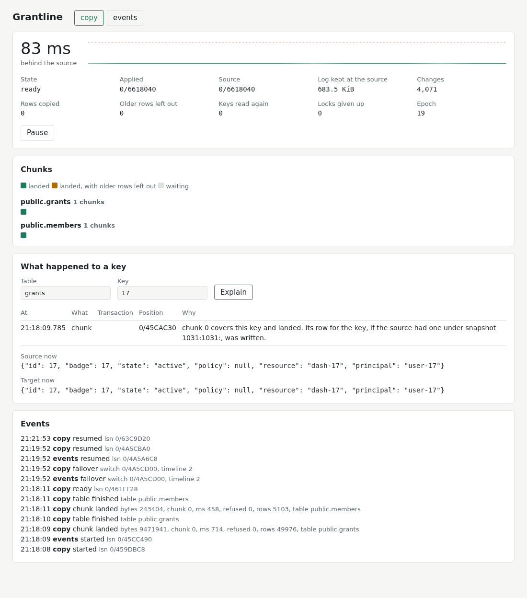

# Grantline

Copies access grants from Postgres to another data center and to Kafka, in Go. It is built so that a revoked grant can't come back.

This is an independent project. It is set in security infrastructure at a company like LinkedIn, all its data is synthetic, and nothing in it comes from LinkedIn's systems.

## The bug it is built around

Copying a live table means reading it in chunks while changes stream past. The usual way to merge the two writes a marker into the log before each chunk and lets the later log position win. On Postgres that can undo a delete. A commit goes into the log before readers can see it. A chunk read in that gap still has the row, the marker in front of it has the later position, and the deleted row is written back.

`repro/revoke_returns.sh` shows it with nothing but Docker:

```
chunk read of 8814:        active (snapshot 755:757:755)
delete in the stream:      transaction 755, committed by 0/1788B70
marker before the read:    0/1788BB0
log position guard:        chunk wins, the revoked grant is back
snapshot guard:            delete wins, the grant stays revoked
```

Grantline asks a different question: was the last change to this key visible in the snapshot the chunk was read under? [Decision 1](docs/adr/01-chunks-are-checked-by-visibility.md) has the rest, including the same gap at the start of a copy and how the first attempt to close it was wrong.

## Measured

On four cores of a Ryzen 9 5950X that run other work too. `make campaigns` repeats it, and `results/` has the output of the last run.

| Check | Target | Measured | |
| --- | --- | --- | --- |
| Revoked grants that return, forced races | 0 in 10,000 | 0 in 10,080 | met |
| The same with the log position guard | at least 1 | 120 of 120 | met |
| Workers killed at random times, both sides compared after each | 200, always the same | 200, half of them in mid-copy, no difference | met |
| Worker paused, replaced, then resumed | no commit from it in 50 tries | 0 in 50 | met |
| Source lost under load, standby promoted | nothing missing or extra | same on both sides, 5 of 5 | met |
| Revoke lag, 40 ms each way, 5,000 changes a second | p99 under 1 s | p50 43 ms, p99 63 ms, worst 583 ms of 2,476 | met, at 4,990 a second |
| One transaction of 5 million rows | under 512 MiB | 72 MiB resident, in a 512 MiB container | met |
| Four apply lanes against one | 2.5 times | 1.9 times, 2.1 with 5 ms to the target and back | **missed** |
| Initial copy against `pg_dump` piped to `psql` | faster | 3.6 s against 2.2 s for 2.5 million rows | **missed** |
| Known bugs caught by their tests | 12 of 12 | 12 of 12 | met |
| Support drill | cause found in 15 minutes by someone new | not run, it needs a person | open |
| Everything starts with one command | ready after 5 s, with an image built beforehand; `docker build` itself hasn't been run | partly |

The copy was meant to be measured with 20 million rows. The disk had room for 2.5 on the last run. [docs/lanes.md](docs/lanes.md) says why the lanes fall short, and [the performance log](docs/performance/README.md) has what was done about the copy and what would come next.

The slowest revoke hasn't been looked into. The tests also pass under the race detector, and the leak profile of Go 1.26 finds no leaked goroutine.

## Try it

```
make up            # two data centers on one machine, then http://localhost:8080
make test          # units, with the race detector
make integration   # against real servers, needs Docker
make leaks         # the same, with the goroutine leak profile
make known-bugs    # puts each known bug back and expects its test to fail
make drill         # a ticket to solve with docs/runbook.md
```

What happened to one row:

```
$ grantline explain -config copy.yaml grants 11
21:06:58.690  delete    transaction 762, committed at 0/17E6E38, epoch 1
21:06:58.714  chunk     0, epoch 1
              FAULT: chunk 0 was read under snapshot 760:767:760,761,762,763,764,765, which can't see
              transaction 762. The change was already here when the chunk landed, so its older row
              should have been left out and wasn't.
source now: no row
target now: {"id": 11, "state": "active", ...}
```

That is the build with the log position guard. The normal build says `refused` there, and why.

## How it fits together

```
 data center 1            data center 2
 ┌──────────┐  stream     ┌───────────────────────────────────────────────┐
 │ Postgres │────────────▶│ assemble ─▶ group ─▶ lanes ─▶ commit in order │─▶ Postgres copy
 │          │  chunks     │                        ▲                      │
 │          │────────────▶│ stage ─▶ guard ────────┘                      │
 └──────────┘             └───────────────────────────────────────────────┘
       ▲  own slot        ┌───────────────────────────────────────────────┐
       └─────────────────▶│ the same, one lane, a Kafka transaction each  │─▶ Kafka
                          └───────────────────────────────────────────────┘
```

| | |
| --- | --- |
| `internal/sched` | parallel lanes, one commit order, and the way out when they block each other |
| `internal/txn`, `internal/pgoutput` | transactions out of the stream, in memory or on disk |
| `internal/source` | slot, stream, snapshots, chunks |
| `internal/target/pgtarget` | apply, the ledger, the guard, the epoch |
| `internal/target/kafkatarget` | the same promises in Kafka |
| `internal/engine` | one replication from start to finish |
| `cmd/grantline` | `run`, `preflight`, `explain`, `recopy`, `serve` |
| `cmd/campaign` | every number in the table above |
| `checker/` | Python, shares no code with the engine, compares live copies |
| `console/` | TypeScript and React over the ConnectRPC API |
| `operator/`, `deploy/` | Kubernetes operator, Helm chart, Terraform for a local cluster |



## Read next

The [decisions](docs/adr), the [runbook](docs/runbook.md), what the [two customers](docs/customers) asked for, [how to write a target](docs/new-target.md), [where AI helped and where it was wrong](docs/team/ai-log.md).

## Not done

- The Dockerfile hasn't been built. The image used here was put together from the same binaries.
- The operator is tested against a fake API server. Helm renders and Terraform validates. None of the three has run on a real cluster.
- Kubernetes Leases are used through client-go and haven't been tested here.
- The bug found in pglogrepl is written up in [docs/upstream.md](docs/upstream.md) and hasn't been reported.
- The two customers are invented.
